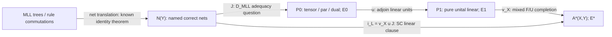

# S2-R2-A — Cross-review of K, K_dec and the pure MLL doctrine bridge

**Role:** Codex A, structural reviewer of [018](018-adversarial-contract-repair.md), initially submitted in PR #28. **Frozen report baseline:** `b0ead595e91350486088789585273a01bb92a530`. Both Phase-A reports were read at that commit. [Task 015](https://github.com/yzm1/proofbasis/blob/5238858b784bfbe535c8cbc145bae61d96ea1761/tasks/015-s2-r2-cross-review.md) is absent from that tree; its authorized instructions were read separately at their addition commit `5238858b784bfbe535c8cbc145bae61d96ea1761`. The branch remains based on the requested baseline. No contact with Codex B, no reading of its developing review, no changes to 017/018 or the charter, and no S3 proof attempt or prover implementation.

**Evidence:** VERIFIED_SOURCE identifies inspected primary statements and their hypotheses; INFERENCE identifies mathematical arguments reproduced here; UNKNOWN is an unresolved comparison or literature status. No result here is FORMALIZED. Reading a published theorem is not independent certification of its full proof; role separation between agents using the same model does not provide that certification.

## 1. Recommendation and findings

**Pursue one bounded prerequisite: certify the exact D_MLL presentation-to-net bridge in 018 §9 against existing unit-free freeness literature. Do not freeze SC as an S3 target yet.** The proposition to audit is the fixed canonical map J in §4, including the empty sequent and all target cut/dual detours. Its best falsifiers are an extra target inhabitant, a target class outside J's image, or a source rule commutation not respected. The elementary crossed/straight matching pair is an important sentinel, but §5 separates that pair even in a concrete model of SC, so it is not an unresolved source of equality collapse.

The immediate negative decision is **STOP K_dec**: the group-word-problem reduction is valid for the actual C_fin and target equality assumptions. K is not refuted by it. The abstract doctrine-indexed construction is existing relative mathematics; it must not be advertised as an all-foundations justification theorem.

New primary leads materially narrow the positive task. Heijltjes–Straßburger's Theorem 5.10 proves freeness of the unit-free MLL net category as a semi-star-autonomous category, including its virtual-unit proof data. Shulman's *-Autonomous Envelopes and Conservativity, Theorem 10.1, proves a stronger free-extension full-faithfulness theorem than either report used. Its hypotheses apply to adjoining units to the **pure** polycategory once the relevant universal property is identified. They do not say that adjoining the mixed F/U doctrine is conservative.

D_MLL is thus a **pure-presentation adequacy prerequisite for the factorized proof strategy**, not literally the MLL clause of SC. SC concerns a composite map into a different, larger target. Neither free initiality nor a doctrine adjunction permits cancelling the intervening map. Section 4 gives the exact diagram and the conditional implications.

## 2. Audit of the broad candidates in 018

| Claim | Cross-review finding | Scope of the decision |
|---|---|---|
| K: `∃K ∀S∈C_fin ∃effective F_S Good(K,S,F_S)` | The source class and schema/certificate convention are independent of K. Effective checking is compatible with undecidable generated equality. No reviewed argument gives the negation `∀K ∃S ∀F ¬Good`. | UNKNOWN existence; do not launch a general proof. Its representation contract admits bounded interpreter controls and does not certify explanatory fundamentality. |
| K_dec: K plus a total equality algorithm on all valid target proof pairs at common translated boundaries/environments | REFUTED by §3's informal reduction using the inspected Boone theorem. Finite core size, fullness, uniform translation discovery and normalization are unnecessary to this contradiction. | STOP the entire existential K_dec for the declared C_fin. Not a refutation of K, SC or D_MLL. |
| D: `∃Phi ∀D∈D_fin ∀finite(Sigma,R) ∃F` with same-fiber proof-class bijections | Shulman 2023 supplies the free completion and its quotient sequent presentation. Finite-input compilation and an independently chosen source quotient are distinct obligations. The exact abstract source in 018 §2 is already the equational calculus of the same doctrine, so that part largely reconstructs established initial syntax. | EXISTING THEOREM baseline; inspect finite schema extraction where its projection lists are explicitly finite. Do not infer arbitrary doctrine-map reflection, or identify this automatically with named MLL nets. |
| D_MLL: the particular no-unit tensor/par/dual witness in 018 §9 | Definite source, target and comparison once the canonical dual/coherence maps are written. Strong unit-free categorical/net prior art exists. Exact transport to the selected Shulman presentation, especially all ports, must be certified rather than assumed. | Highest bounded decision value as a prerequisite/literature-comparison task. No new universal framework is warranted. |

**K's trust qualification is necessary but not an interpreter discriminator.** For a finite graph table, the explicitly opaque checker in 018 §3.1 accepts exactly paths and its fixed box equality removes administrative certificates. It can satisfy literal TR without importing trusted rule constants: the table is checked data in a source-dependent boundary. That example neither proves K for all C_fin nor refutes it. C3 case-analysis templates in §3.2 similarly demonstrate a compound constant-type loophole, not a general construction. Fullness rejects that particular C3 target class containing `(tag_0,1)` but still accepts the graph checker. The limits in 018 are correctly stated.

**D's trust qualification changes the theorem.** A relation in R is designated additional proof equality, not derived in an unchanged core. Finite group presentations therefore cause no paradox in D: its same-fiber equality may be undecidable. A map of doctrines adding contraction or axioms can preserve derivations and equations without reflecting either. The naturality of the family and Shulman's pseudo-adjunction do not make those maps embeddings. The finite-coherence discussion in 018 does not refute D's finite ordinary schemas; its stronger FDT/convergence claim requires preservation of the same presentation/higher structure.

## 3. Independent reproduction of the K_dec obstruction

### 3.1 An actual C_fin source, not an appeal to its claimed membership

Fix the finitely presented group G whose existence is asserted in Boone, *The Word Problem*, PNAS 44(10), 1958, p. 1061, **Result a**. I inspected the original five-page article scan; Result b additionally states a recursive reduction from Thue equality. Result a is the only external existence input needed here. The scan gives a finite presentation construction and refers to prior results in its proof; this review does not independently rebuild that group construction.

Write its finite presentation as `⟨a_1,...,a_n | r_1=1,...,r_m=1⟩`. Construct S_G with one object/port sort p and the following finite schematic syntax:

```text
id:p→p;       a_i:p→p;       a_i_bar:p→p;
composition (matching p ports);
associativity/unit;
a_i a_i_bar = id = a_i_bar a_i;
r_j = id  (each finite relator word uses the listed inverse letters).
```

In an open one-port form these are terms `x`, `a_i(t)`, `a_i_bar(t)` with a single hypothesis or derivation hole `x:p`. Relator equations are finite pattern pairs `r_j(x)=x`; composition is capture-free replacement of that hole. There is no binding, dependent conversion or semantic side condition. Context permissions retain that one port rather than supplying cartesian duplication. The environment can be empty. The machinery and relators are explicitly marked source declarations, not assumed mathematical proofs in Env.

Every raw word term is a valid finite certificate. Checking its constructors and port typing is decidable without deciding a group equation. If an equality derivation is supplied, a finite sequence of declared relations and contextual replacements is also checkable; deciding whether such a derivation exists is different. The least composition congruence is the congruence of the displayed group presentation. Thus

```text
w(x) ≈_S_G x    iff    w=1 in G.
```

This verifies each relevant C_fin membership condition in 018 §1.1: finite sorts, constructors, rule/equation patterns, decidable raw checking, explicit one-port composition/substitution and permissions. G's undecidable quotient equality is expressly allowed by that class. No change to the source class is needed.

### 3.2 The reduction, including nonuniform effectiveness

Assume K_dec. Choose the effective translation F_G promised for this **one fixed S_G**, and the target decider E_K. Let b be the fixed one-port/hypothesis boundary containing x. For any finite input word w:

1. Construct the valid raw source proofs `w(x)` and `x`.
2. Compute their target proofs/certificates `F_G(w(x))` and `F_G(x)`.
3. Run E_K on them at the **same translated boundary F_G b**, in the same translated environment.
4. Return its answer.

EP gives the forward implication, ER the reverse:

```text
w=1 in G
  iff w(x)≈_S_G x
  iff F_G(w(x))≈_K F_G(x)
  iff E_K(F_G(w(x)),F_G(x))=yes.
```

This would decide G's word problem, contradicting Boone's result. There is no appeal to R_int or fullness, and no proof search to obtain a target inhabitant: the effective derivation/template map produces valid target certificates. A decider with a promise that inputs are valid comparable proofs suffices, because these inputs meet the promise.

The quantifier order causes no escape. `∃K ∀S ∃effective F_S` yields some finite program for F_G; hardwiring that program and K's decider gives a program for the one hard G. We do not need to discover F_G uniformly from an arbitrary presentation. An atom image containing G as closed data is also no escape: the decider must work at **all translated types**, including that type. Mapping each proof to a different proof-dependent boundary would invalidate the stipulated map on a fixed b, not satisfy K_dec.

| Hypothesis | Present in the frozen claim? | What removing it changes |
|---|---|---|
| Hard S_G belongs to C_fin | Yes, construction above | Excluding this system narrows the source class. |
| F_G computable on raw word proofs | Yes | Merely set-theoretic embeddings do not give this algorithm. |
| Outputs are valid at one common boundary | Yes, effective typed/templates map | A proof-code-in-the-boundary map that loses comparability is a different contract. |
| EP and ER use the **same target congruence** | Yes | Only P/R, only EP, or an internal equality proposition do not suffice. |
| E_K terminates and decides that congruence on the images | Yes, K_dec | Decidable raw checking or equality-certificate checking is weaker. |

**Finding:** no missing hypothesis in 018's reduction. It excludes every proposed K_dec witness, even one with source-specific derived type data. It does not exclude K with undecidable equality, or a target equality algorithm restricted to an easy fragment not containing these images. The latter is a new claim, not a rescue of K_dec.

## 4. D_MLL versus SC: the actual objects, maps and equalities

### 4.1 The source quotient and three different targets

For a finite set Y of atoms let N(Y) be the symmetric proof polycategory of **correct cut-free unit-free no-mix MLL nets**, with named boundary leaves, ordered tensor/par arguments and atomic dual links. Its hom-set at `Γ→Δ` uses the concluding forest `Γ^⊥,Δ`. Composition inserts cut along a designated occurrence and reduces it. Equality is identical axiom matching on the fixed forest, not mere provability and not equivalence under arbitrary relabeling of ports. Implicit exchange is a specified symmetric action, not identification of distinct arrows after that action.

Let Q(Y) be the source sequent derivations modulo the corresponding rule commutations. van Glabbeek–Hughes Theorem 1 and sequentialization give `Q(Y)≅N(Y)`. In this multiplicative restriction the different papers' additive net representations reduce to the same linking/forest. The source cut operation is net normalization, not raw cut-free tree grafting.

Define three targets, all freely generated by the indicated atom declarations and **no nonidentity proof generators**:

* **P0(Y):** 018's D_MLL completion. Base `sympoly`; exactly binary tensor, binary cotensor/par and unary dual universal cones. No units, counits, mix, additives or nonlinear objects. Equality E0 is the full structural and universal β/η congruence of Shulman §8; all cut and dual detours count.
* **P1(Y):** the pure linear completion adding the linear unit/counit cones to P0's doctrine. Equality E1 uses its corresponding universal equations. This intermediate object is for analyzing the existing claims, not a replacement candidate.
* **A*(X,Y):** 017's SC target with finite nonlinear atoms X, nonlinear terminal/product/hom, linear tensor/par/unit/counit/dual and covariant F/U. Equality E* includes all corresponding structural/universal laws, with neither mix nor `FU=id` imposed. Its linear hom-sets at translated boundaries allow all mixed interior detours.

There are canonical structure-preserving interpretation maps

```text
Q(Y) ≅ N(Y) --J--> P0(Y) --u--> P1(Y) --v_X--> A*(X,Y).
                              L_X = v_X u
                 i_L = L_X J  (up to the specified boundary isomorphisms).
```

J maps a literal p to its atom, p^⊥ to its chosen dual, and tensor/par to the named universal objects. Atomic axioms use dual coevaluation, derived from the dual's universal property. In Shulman's formulation dual evaluation is `p,p*→∅`; its Hom bijection applied to `id_p` gives `∅→p*,p`. Tensor/par rules are the named universal maps/factorizations. De Morgan and double-dual boundary maps are canonical **isomorphisms**, not new definitional equations declaring all syntactic negations equal.

u and v_X come from the inclusions of the named doctrines and their free universal properties. Those properties establish interpretations, not automatic full faithfulness. The composite interpretation is the direct SC translation by freeness once its source templates/coherence are verified. A change of chosen representatives may insert isomorphisms; it must not insert extra proof equations.



On raw same-boundary proofs d,e the two equality questions are exactly:

```text
λ(d)=λ(e)             iff d≈comm e              (published source theorem)
Jλ(d) E0 Jλ(e)        iff λ(d)=λ(e)             (D_MLL ER/EP bridge)
i_L λ(d) E* i_L λ(e)  iff λ(d)=λ(e)             (SC linear ER/EP bridge).
```

D_MLL additionally asks `∀t∈P0(iΓ) ∃n∈N(Γ): Jn=t`; SC asks the analogous statement for **every** class in A*(X,Y)(iΓ), a larger ambient target. Restricting proofs' *interiors* to the image of P0 proves only a relative result and cannot establish SC.

For NJ the separate map is

```text
NJ(X)/βη ≅ C(X) --i_N--> A*(X,Y)^NL,
```

where C(X) is the free cartesian proof structure at the source unit-free types, including terminal contexts. This nonlinear assertion is another conjunct of SC; no D_MLL theorem implies it.

### 4.2 Exact logical implications: do not cancel an unknown functor

Assume the comparison maps and their typed coherence have been established. Write FF for bijections on all hom-sets at the specified source boundaries.

| Premise | What follows | What does not follow |
|---|---|---|
| SC's linear clause says `L_X J` is FF | J is faithful: an E0 equality is preserved by L_X and reflected by the composite | J need not be full unless L_X reflects equality on P0 arrows; SC alone is not literally all of D_MLL. |
| D_MLL says J is FF | The pure-source quotient is exactly P0 at its translated boundaries | L_X may add inhabitants or identify arrows; SC remains unproved. |
| J is FF and L_X is FF on those P0 boundaries | The linear part of SC | Not SC's NJ clause or its finite-schema/effective/presentation conjunction by itself. |
| SC linear FF plus L_X faithful on those P0 boundaries | J is full as well: for t in P0, use composite fullness for L_X t and then cancel L_X | Faithfulness of L_X is an extra hypothesis; a doctrine adjunction does not supply it. |
| J is FF and SC linear FF | L_X is FF on the corresponding P0 hom-sets by transporting the two bijections | This is a consequence *after* the pure bridge; not a way to assume that bridge. |

The cancellation caveat is logical, not just rhetorical. For one-object monoids, let the source be `{1}`, the intermediate target `{1,a}` with `a²=a`, J the inclusion, and L the quotient killing a. LJ is an isomorphism although J is not full. This is not a counterexample in the chosen LNL doctrines; it shows why full faithfulness of a composite alone cannot establish fullness of its first factor.

Consequently an equality-collapse counterexample to D_MLL ER would refute SC ER **through this compatible factorization**. A D_MLL-only nonimage arrow may disappear under L_X and need not refute SC. Conversely a new mixed target class can refute SC while D_MLL remains true. A target-only modality proof is not a D_MLL counterexample: P0 has no such modality.

**Classification:** D_MLL is a prerequisite for the proposed pure-net/factorization proof strategy and an independent pure adequacy component. It becomes SC's linear special case only after identifying P0 with the relevant pure ambient target and proving the intervening unit/mixed extension is conservative. Its equality-reflection subclaim is a consequence of SC plus the compatible maps; its entire fullness claim is not an unconditional consequence. It is neither a theorem that SC is impossible nor a substitute for SC.

### 4.3 What the newly inspected conservativity theorem supplies

Shulman 2021, Theorem 10.1, concerns a **small symmetric polycategory P with a designated collection J of existing tensor/cotensor universal products**, and its universal extension to a star-autonomous category preserving J up to isomorphism. That universal map is fully faithful **polycategorically**, including arbitrary boundary arities. This is a free-extension result, stronger than the mere existence of some full embedding. Its definition and theorem must be used together.

Apply that statement with P=P0 and J all its existing binary tensor/par products. Duals are preserved by polycategory functors. The free unital linear completion P1 has the required universal property by combining its freeness with P0's; hence identification of u with the theorem's universal map supplies full faithfulness of u. This application is an **INFERENCE from the inspected theorem and universal properties**, not a newly mechanized result. It does not presuppose D_MLL's identification with source nets.

Thus adding pure linear units is not an unsourced general objection to these particular fragment hom-sets. The unresolved extra map is v_X. The 2021 theorem has no nonlinear cartesian zone, no F/U adjunction and no additional nonlinear atom set X in its target universal property. It cannot be cited as full faithfulness of v_X. Treating a cartesian closed category as symmetric monoidal closed also does not automatically produce the specific mixed adjunction of SC.

## 5. Concrete control attempts and their outcomes

### 5.1 NJ βη and conservative named generators

At a typed unrestricted boundary with u:A and v:B,

```text
π1⟨u,v⟩ = u;        λx.fx = f  (x not free in f).
```

The cartesian product/exponential universal laws verify these in C(X) and under the canonical nonlinear i_N. The source open-hole substitution law gives `(λx.t)s=t[s/x]`; it is not a serialization theorem. Adding `k_{A,B}=λx.λy.x` with its defining equation leaves proof classes unchanged under expansion. Adding k without that equation introduces an additional proof constructor and is not the same extension.

In the deep LF encoding with inert `imp_i`,`imp_e`, `imp_e(imp_i(λz.z),x)` remains constant-headed; it does not reduce to x under LF β. This is a specific EP failure for the NJ β quotient. Raw LF adequacy does not repair it. Hasegawa's published arrow-fragment translation instead verifies exact equality, native substitution and intrinsic fullness at its dual-context boundaries. Neither calculation establishes product-and-modal **ambient** fullness for SC.

### 5.2 No-mix MLL rule commutation

Tensor the p and r atomic axioms to obtain

```text
D: ⊢ p*,r*,p⊗r.
```

Use a q axiom and compare applying par to p*,r* **before** tensoring `(p⊗r)` with q, against applying it **after** that tensor. Both end at

```text
⊢ (p*⅋r*), ((p⊗r)⊗q), q*.
```

Each has the same three named dual axiom links. The published commutation theorem identifies them in the source. Tensor/par universality and equivariance predict the same equation in P0; this is one finite EP test of J, not a proof that its full β/η congruence matches all nets. In a raw rule-constructor encoding their outer heads differ, giving an actual EP negative control. Preserving only the conclusion would miss it.

### 5.3 Distinct axiom matchings: a separating mixed model

At the fixed forest `⊢p_1*,p_2*,p_3⊗p_4`, the straight links `(1,3),(2,4)` and crossed links `(1,4),(2,3)` are both correct no-mix nets: each switching graph is a tree. Their source classes are unequal. Exchange acts on named ports; it is not a license to forget which matching was made.

There is a concrete model separating their images **even under E***. Use nonlinear `FinSet`, linear finite-dimensional vector spaces over `F_2`, F the free-vector-space functor on a finite set, and U the underlying finite set. Then `F⊣U`, `F(S×T)≅FS⊗FT`, `F(1)≅I`; finite vector spaces are compact closed and hence supply the linear star-autonomous structure. FinSet is cartesian closed. These operations give a model of D*. A model may have additional morphisms/permissions without asserting they are generated in the free target.

Interpret the atom p by `V=F_2²`. After bundling the two negative inputs via the canonical tensor boundary map, the matchings interpret as `id_{V⊗V}` and the swap. On `e_0⊗e_1` the results are respectively `e_0⊗e_1` and `e_1⊗e_0`, distinct basis vectors. All D* equations hold in the model, so an E* equality of this pair would be unsound there.

**INFERENCE:** this pair passes ER for the actual P0/P1/SC constructor images. A proof-irrelevant target that identifies them is a real failed alternative representation, not a counterexample to the frozen D* equations. The calculation does not establish ER for all nets or R/fullness: the model contains many maps not generated by either source or target.

### 5.4 A genuine target-only modality detour and an invalid one

The mixed core has a genuine pure-endpoint detour involving intermediate modality types. Let 1_N be its nonlinear terminal object and I its linear unit. F is strong monoidal on the represented linear multicategory, so choose the canonical isomorphism `f:I≅F1_N`. With adjunction unit η and counit ε,

```text
s = f^-1 · ε_(F1_N) · Fη_(1_N) · f : I→I,
h = ρ_p · (id_p⊗s) · ρ_p^-1 : p→p.
```

The triangle identity makes s=id_I; functoriality/unit coherence makes h=id_p. The intermediate type `FUF1_N` is absent from pure MLL. This is a positive finite **E*** detour test: one cannot forbid all modal interiors as a shortcut to SC. It is not a theorem that every such detour cancels. These triangles follow from the stated universal adjunction; no `FU=id` axiom is imported.

By contrast the attempted macro `p(linear)→Up(nonlinear)→FUp→FUp⊗FUp` cannot begin with that first arrow in the declared split context. Producing Up uses a proof of p with empty linear context; linear input p cannot be silently moved there. It is not a valid target proof and cannot refute SC. Accepting it would be a mode/typing failure, not a sophisticated counterexample.

### 5.5 Resource and trust attacks

The source sequent `p⊢p⊗p`, equivalently `⊢p*,p⊗p`, has one negative and two positive atomic leaves; it cannot have a complete dual axiom matching. Translating it to unrestricted product admits `(x,x)`, a genuine R failure for that boundary map. A less naive map `p↦FX` still admits a derived diagonal

```text
FX --FΔ_X--> F(X×X) ≅ FX⊗FX.
```

This exploits an actually copyable modal image, not a faulty target contraction rule. It refutes the proposed direct boundary translation of the linear atom to FX; it does not refute SC's fixed atom map `p↦Y_p`, or every K permitting other compound interfaces. Pure proof-identity reflection would not alone detect new inhabitants.

Adding a target proof constant `c:∅→Y_p` would also create an extra inhabitant, but neither D_MLL nor SC permits that addition to its frozen empty proof-generator ledger. It is a trust violation, not a counterexample meeting their hypotheses. D accepts new `(Sigma,R)` generators as marked parameters, so comparison must use the **same** parameter input on both sides. A theorem in that expanded fiber proves no empty-ledger theorem. Relocating a primitive rule into a hidden hypothetical assumption changes TR; treating that move as an allowed unmarked equivalence invalidates the original comparison.

| Test | Source identity/resource fact | P0 versus A* outcome / reach |
|---|---|---|
| NJ projections/function βη | Matching introduction/elimination equations; scoped substitution | Finite positive nonlinear equation tests; ambient fullness UNKNOWN. |
| Par/tensor commute | Identical occurrence linking | EP sentinel; no full P0 quotient certification from this example alone. |
| Straight/crossed matching | Distinct linking, both valid | Separating D* model rules out this pair's collapse; proof-irrelevant alternative fails ER. |
| Modal triangle scalar inside p→p | Source id_p | Genuine A*-only proof equals source image; P0 contains no F/U test. |
| Move linear p directly to nonlinear Up | No licensed context transition | Rejected as ill-typed; not an SC falsifier. |
| Tensor/product or p↦FX diagonal | Source atom imbalance | Actual R failure for those maps; not the frozen atom map. |
| Add a closed atomic target constant | Source empty ledger has no proof | Breaks TR/premises; D comparisons must retain identical parameter ledgers. |
| Dependent telescope / cyclic graph | Reindexing types / progressing global trace | Outside P0 and SC's declared source fragments; K includes them only with its explicit finite certificate contract. Local-port failure does not refute all K. |

All calculations above are finite informal mathematical tests. No new proof-search or net-checking implementation was used.

## 6. Primary literature audit: strongest existing results and exact limits

The needed theorem texts were read from original articles/author PDFs, not only abstracts. Scratch PDFs and text extraction are outside this PR. Primary statement verification does not certify the entire proof. Earlier-session primary files for Shulman 2023, Girard and van Glabbeek–Hughes were retained and their relevant passages reread. The publisher archive for Boone presented a browser challenge; an original-article scan at the mirror below was accessible. The Heijltjes–Straßburger author PDF was downloaded/read directly despite the web PDF reader failing for that URL.

| Primary source / inspected passage | Actual hypothesis and conclusion | What it establishes here / limit |
|---|---|---|
| Boone, *The Word Problem*, PNAS 44(10), 1061–1065 (1958), [original scan](https://www.aemea.org/math/Word_Problem.pdf), [publisher DOI](https://doi.org/10.1073/pnas.44.10.1061), p. 1061 Results a–b | A finitely presented group with unsolvable word problem exists; the paper also states a recursive Thue-to-group equality reduction. | VERIFIED_SOURCE existence input. The source-calculus embedding and target equality reduction in §3 are independently reproduced INFERENCE; no full Boone construction audit claimed. |
| Shulman, *LNL polycategories and doctrines of linear logic*, LMCS 19(2:1), 2023, [primary v5 PDF](https://arxiv.org/pdf/2106.15042), Defs. 2.10, 4.14–4.16, 5.1; Thm. 7.4; §8 Prop. 8.3 and following equality paragraph; Thms. 9.1–9.2 | Small doctrine/sketch has free completion in the stated (2,1)-categorical sense. Restricted §8 assumes unsorted/subterminal base and finite discrete cones; supplies syntax and quotient. Doctrine maps induce pseudo 2-adjunctions. | VERIFIED_SOURCE. P0 and A* use different doctrines. §8 explicitly leaves cut elimination for future study; its quotient theorem is not a source-MLL permutation theorem. Prop. 3.1 applies to the represented multicategory underlying the mixed model for the F/U triangle test. |
| Heijltjes–Straßburger, *Proof nets and semi-star-autonomous categories*, MSCS 26(5), 789–828 (2016), [author text](https://www.lix.polytechnique.fr/Labo/Lutz.Strassburger/papers/fssac-final.pdf), Defs. 2.1–2.5, 3.1, 5.1, 5.8; Prop. 5.7; Thm. 5.10, author-text p. 19 | For the atom category A and a functor into a **double-dual-strict** semi-star-autonomous category, there is a unique structure-preserving extension from net(A), up to natural isomorphism. The morphism notion includes a natural transformation on virtual-unit data, not just an ordinary functor. Nets use named occurrence linkings and connected/acyclic switchings. | VERIFIED_SOURCE. Strong unit-free net freeness; one-conclusion proofs are virtual-unit elements. Transport to Shulman's chosen-dual polycategory, arbitrary ports and empty sequent must be spelled out, not inferred merely from a title. |
| Shulman, *-Autonomous Envelopes and Conservativity*, EPTCS 353 (2021), 175–194, [primary text](https://arxiv.org/pdf/2004.08487), §6 distinguished tensor/cotensor products; Thm. 10.1; Cor. 10.6, [DOI](https://doi.org/10.4204/EPTCS.353.9) | A small symmetric polycategory with designated existing tensor/cotensor products has a fully faithful universal extension to a star-autonomous category preserving them up to isomorphism. Closed symmetric monoidal conservativity is a corollary. | VERIFIED_SOURCE. Supplies the pure unital-extension comparison after universal-property transport; not a theorem about adding nonlinear resources and F/U. Does not identify source net equations with P0 by itself. |
| van Glabbeek–Hughes, *MALL proof nets identify proofs modulo rule commutation*, [primary text](https://arxiv.org/pdf/1609.04693), §2, Tables 2–4, Thm. 1 | Unit-free cut-free MALL proofs on the tracked conclusion have identical net translations iff related by rule commutations, with or without mix. | VERIFIED_SOURCE. Choose the **no-mix multiplicative** specialization; establishes `ker λ=≈comm`. Not Shulman's cut/dual universal congruence by itself. |
| Girard, *Proof-nets: the parallel syntax for proof-theory*, [author text](https://girard.perso.math.cnrs.fr/Proofnets.pdf), Def. 10; Thms. 1–2 p. 10; Thms. 3–4 | Under the paper's weighted proof-structure conditions, switching-correctness and sequentializability coincide. Lazy reduction has a unique normal form; in the additive-free restriction it is cut-free. | VERIFIED_SOURCE. Multiplicative restriction gives the independent correct-net target, its composition and fullness from sequents. Does not normalize the whole mixed core. |
| Blanco–Zeilberger, *Bifibrations of polycategories and classical linear logic*, MFPS 2020, [primary author PDF](https://nicolas-blanco.github.io/publication/conference-paper/conference-paper.pdf), Def. 2.5; Thms. 2.15, 3.9 | Representability requires tensors/pars of **all finite lists, including the nullary cases**. With duals it connects polycategorical structure to star-autonomous categories. | VERIFIED_SOURCE. Do not cite this unital statement alone as equivalence for 018's unit-free doctrine. It helps identify P1, not a direct certificate of P0's net bridge. |
| Došen–Petrić, *Coherence of Proof-Net Categories*, 2005, [primary text](https://arxiv.org/pdf/math/0503301), §3 free PN-neg construction; §4 PN-neg Coherence; §8 its proof; §§9–10 separate mix extension | The canonical functor from the freely presented proof-net category to Brauer graphs is faithful. A distinct mix version is treated separately. | VERIFIED_SOURCE. Important unit-free coherence prior art; faithfulness is not alone full sequentialization or a claim about SC's mixed modalities. |
| Hasegawa, *Girard Translation and Logical Predicates*, JFP 10(1) (2000), [primary PDF](https://www.cambridge.org/core/services/aop-cambridge-core/content/view/33BFABF75573B9D81D9BBE51E0D6C524/S0956796899003615a.pdf/girard-translation-and-logical-predicates.pdf), Props. 3.1/3.3/3.4, Lem. 3.2, Thm. 5.6 | Arrow STLC βη maps to the specified dual-context linear calculus with !, with equality preservation/reflection and substitution. Every inhabitant at a translated boundary equals a source image. | VERIFIED_SOURCE, precise positive non-native-boundary control. No product, classical MLL or full D* extension is inferred. |

Lamarche–Straßburger's [2006 primary article](https://arxiv.org/pdf/cs/0605054), Theorem 2.3.1, was also inspected: its free star-autonomous category theorem **includes units**, and its proof-net equality includes their treatment. It is not silently substituted for D_MLL's unit-free claim. The more directly matching unit-free result is Heijltjes–Straßburger above.

**Literature status decision:** neither report should present free unit-free MLL proof machinery as a novel conjectural area. There are published freeness/coherence theorems with strong matching content. However the exact target is a *particular* Shulman completion with its entire E0 congruence. This review has not certified the complete equivalence between that chosen presentation and the published semi-star-autonomous model, including empty ports. That is a bounded theorem-transport obligation, not evidence of a new open general existence theorem. No inspected primary statement settles v_X or SC's nonlinear part. A targeted search failure is not a proof they are open.

## 7. One exact next proposition and hard exit

**Select the D_MLL bridge as a bounded prerequisite/literature audit, not SC and not general K.** Keep the following immutable text with P0, N, J and E0 as defined in §4:

```text
For every finite atomic generator set Y and every named one-sided
unit-free no-mix MLL sequent Γ, including Γ empty,

  J_Γ : N(Y)(∅;Γ) → P0(Y)(∅;jΓ)

is a bijection, natural under exchange, formula substitution,
and the specified cut-and-net-normalization compositions.
All P0 cut/dual detours are allowed; equality is E0.
There are no extra proof generators, units, MIX or equality imports.
```

This is 018's proposed D_MLL specialization with its previously implicit empty boundary made explicit, **not a repaired target chosen after a counterexample**. The proposition extends to two-sided boundaries by the specified duality/De Morgan isomorphisms; their coherence is part of the typing audit. The empty sequent has no source net, so its target hom-set must be empty.

**Bounded prerequisite to certifying that proposition:** identify Shulman's tensor/par/dual cone universal properties with the published unit-free net structure and its virtual-unit proof data. In particular check not only the two-conclusion ordinary category but also one-conclusion/empty-input hom-sets, canonical double-dual maps and the empty sequent. Heijltjes–Straßburger do not provide a physical unit object to add to P0; virtual-unit data must not be promoted to one. A generic category with virtual-unit data should not simply be declared equivalent to *all* polycategories at an empty/empty boundary without a construction. The free no-generator setting is the setting being compared.

**Proof entry, if later authorized:** use the two free universal properties to construct inverse structured interpretations, or verify the finite §8 generators/equations in correct nets and prove the inverse on their full quotient. The published sequentialization/commutation results then supply the source comparison. This review performs the source/literature and finite tests above; it does not begin a general cut-elimination proof for the target.

**Best mathematical falsifiers:**

1. A well-typed P0 proof of the empty sequent or `⊢p*,p⊗p` with the empty proof-generator ledger: R fails by the source matching invariant.
2. A P0 class at a source-derivable Γ that cannot equal any correct net image: fullness fails even though R can hold. A useful witness must demonstrate nonimage status by a target invariant, not failed proof search.
3. A source tensor/par rule commutation with inequivalent P0 images: EP fails and J is not a map on the chosen quotient.
4. Two different correct source linkings whose images are E0-equal: ER fails. The simplest straight/crossed example is already excluded by the separating model in §5; a genuine counterexample must meet the full frozen equations and typing rather than assume proof irrelevance.

One failed encoding or an illegally imported constant is not any of these. A D_MLL bridge failure rejects that witness; it does not refute all family compilers. SC is affected by such a failure only through the precise implications in §4.2, not by calling the targets the same.

**Yes/no exit:** if the exact universal-property transport is verified from these published results, close this prerequisite as **EXISTING THEOREM** and stop duplicate D_MLL proof work. The remaining potential S3 target would then be the explicit mixed-extension full-faithfulness question for v_X (plus SC's NJ clause), to be selected separately by the coordinator/user. If a genuine falsifier appears, record its failed clause and stop advancing the proposed bridge; do not rescue it with units, mix, new equations or image restrictions. If no matching primary theorem or certified bridge is yet available, undertake only this specific comparison, not another general definition round.

**Final recommendation:** pursue that bounded prerequisite; **STOP K_dec**, reuse the established doctrine-family/free-net results, and defer freezing SC until the pure target identification and the already-known pure unit conservativity are separated from the actual mixed-modal claim. This preserves a concrete bridge to cross-foundation generation while respecting the S3 gate. No implementation or all-foundations proof is authorized by this recommendation.
