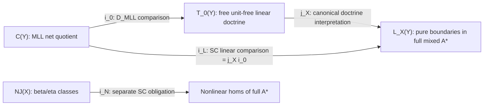

# S2-R2 — Cross-review by the adversarial agent

**Role:** Codex B. **Frozen report baseline:** main `b0ead595e91350486088789585273a01bb92a530`. **Primary target:** [017, SC and DI](017-structural-contract-repair.md), submitted in [PR #29](https://github.com/yzm1/proofbasis/pull/29). **Comparison:** [018, K_dec and D_MLL](018-adversarial-contract-repair.md). This is a separate independent cross-review, not an amendment to either report. No communication with Codex A and no reading of its developing review 019 occurred.

**Task provenance:** `tasks/015-s2-r2-cross-review.md` is absent from the frozen baseline. The authorized [task](https://github.com/yzm1/proofbasis/blob/5238858b784bfbe535c8cbc145bae61d96ea1761/tasks/015-s2-r2-cross-review.md) was read from main commit `5238858b784bfbe535c8cbc145bae61d96ea1761`; only that task was taken from the later tree. The branch and reviewed reports remain at the requested baseline. Read AGENTS.md, its prerequisite documents, the canonical plan and S2-R1 gate. S3 proof attempts, software, charter changes and source-report edits are not undertaken.

**Verdict: PROCEED to select and freeze the original SC as one bounded mathematical proposition, subject to the logged gate and subsequent authorization; do not launch S3 in this review.** Its free ambient core has an established construction, and its unresolved content is exact pure-fragment conservativity/fullness in that core. No actual counterexample to frozen SC was obtained. D_MLL is a different, smaller comparison with strong prior-art coverage; it is not an unconditional special case of SC. STOP K_dec for the broad source class, by the independently rechecked reduction. Stop treating free generation alone as evidence of universal explanatory fundamentality.

**Evidence labels:** VERIFIED_SOURCE means the identified primary statement and relevant hypotheses were inspected, not independently proof-certified. INFERENCE means a bounded informal mathematical argument in this review. UNKNOWN means an unresolved obligation or literature status. Nothing here is FORMALIZED. Agreement between these same-model reports is not independent mathematical certification.

## 1. Findings that determine the decision

1. **SC specifies a meaningful fixed target, not an arbitrary search over all finite cores.** Its source atoms, resource zones, logical operations and target equality are fixed through Shulman's definitions and §8 presentation. The finite-schema construction is a restricted extraction from published mathematics. The claim that both pure fragments give bijections into the full mixed target is a further assertion, not a consequence of that construction.
2. **The dangerous gap is fullness and equality conservativity, not raw encoding.** A target proof at a pure boundary may contain F/U, linear units, opposite-zone formulas and universal-factorization detours. Counting only modal-free representatives, or checking only source-generating equations, would prove a different statement.
3. **There is an actual canonical comparison map `j:T_0(Y) -> A*(X,Y)_L`.** It follows from the free D_MLL construction and the linear reduct of the mixed structure. It preserves equations and the chosen operations. No inspected theorem makes j automatically faithful/full. The conditional implications in §5 keep that distinction explicit.
4. **Prior art is closer than a generic free-object theorem, and one older proof route has a published correction.** Unit-free net freeness, net descriptions of free star-autonomous categories with units, and fragment full-completeness results have primary statements. Shulman's later envelope paper explicitly challenges the older double-gluing proof of the relatively free classical extension and supplies another proof of its conclusion (§6.2). None of the inspected statements, without further matching/lifting arguments, certifies the exact simultaneous mixed SC claim. A failed search is not a claim that SC is open or novel.
5. **K_dec's first required hard source really belongs to the stated broad class.** Effective EP+ER into a decidable target congruence decides its group word problem. This excludes every target satisfying that strengthened contract. It does not attack SC's two-fragment class, D_MLL's empty generator ledger, or arbitrary finite cores with undecidable equality.

## 2. Audit of SC's core and its finite presentation

### 2.1 The object that is actually quantified

Use report 017 §6 and Card SC **unchanged**. D* is the LNL doctrine with nonlinear terminal/product/internal hom, linear tensor/cotensor/unit/counit/dual, and covariant F/U. The arity base is the terminal `lnlpoly`, not a bare CCC, an intuitionistic single-output linear category, or a disjoint union of two calculi. `A*(X,Y)` is its free completion on disjoint finite nonlinear/linear atomic object sets, with no nonidentity generating proof arrows.

An audit spelling of its mutually generated type grammar is:

```text
N ::= X | 1_N | N x N | N => N | U A
A ::= Y | 1_L | bottom_L | A tensor A | A par A | A* | F N.
```

This is ten logical type-former schemas, plus the two kinds of atom declarations. Linear internal hom can be derived from dual/par; it is not an additional unrestricted primitive in the frozen list. Other operations appearing in a general LNL framework must not be added without derivations. In particular, there are no additives, MIX, `FU=id`, a unit/counit identification, trusted proof constants or arbitrary rewrite tables.

The two families of homs have different types:

```text
nonlinear: P(Theta ; N)
linear:    P(Theta | Gamma ; Delta).
```

Theta admits finite-function structural actions (including contraction/weakening). Gamma and Delta admit only permutations. Nonlinear cut substitutes a nonlinear proof into a nonlinear slot, including a slot of a linear proof. Linear cut connects one selected output/input occurrence and retains all other ports. There is no self-trace or operation connecting arbitrary pairs of already joined ports. In particular, a directed cycle is not licensed by the polycategory composition laws.

**VERIFIED_SOURCE:** these actions and cuts are Shulman Definition 2.1. Consequently, passing a linear assumption to an unrestricted slot is not an innocuous context coercion. Raw multiplicity of an NJ term is not a beta/eta invariant, whereas an MLL boundary occurrence remains a labeled linear port.

### 2.2 Constructors and equality that must be charged

The report identifies a semantic doctrine rather than listing a standalone executable calculus. This is adequate for a theorem-shaped question **provided the reference is to the exact published §8 presentation and its entire congruence**, not an unspecified subset of familiar equations. That reading is the one audited here.

For the finite cone list, the generic presentation contains identity, the typed cuts, structural actions, the finite projection/universal morphisms, and inverse-factorization operations with a variable admissible context parameter. Nonlinear terminal has a nullary reconstruction operation; binary product has its finite projection tuple; implication has evaluation/transpose. Tensor, cotensor, linear units and dual use their signed universal-morphism cones. F/U use the cones in Definition 2.14. Finite generators must not stand for infinitely many unlisted projections or an external uniqueness oracle.

The exact quotient has:

* identity/associativity, equivariance and polycategorical interchange;
* principal beta laws saying inverse factorization followed by the designated projection recovers its premise;
* eta/reconstruction laws saying a proof equals the factorization of its composites with the designated projections, **at every admissible ambient context**;
* the resulting canonical structural isomorphisms and their naturality. Strict equality of raw double-dual expressions is not postulated.

Shulman §8 Proposition 8.3 is surjectivity from the calculus to the free completion; the following paragraph gives the quotient. Theorem 7.4 supplies the free completion in a (2,1)-categorical sense. Neither statement by itself identifies its full equality on pure boundaries with NJ beta/eta or MLL net matching.

**Finite-extraction assessment — INFERENCE:** the chosen finite projection lists allow finitely many factorization/beta/eta schemas, each with finite premises and explicitly generated context/structural syntax. Reconstruction can replace a conditional uniqueness test. This is the finite consequence claimed in 017, not a finite convergent rewrite theorem or a finite higher homotopy basis. The same argument fails if a “finite description” actually leaves an arbitrary projection family or equality test in an index. The terminal reconstruction case and signed typing deserve explicit checking, but no finite-coherence obstruction currently refutes this extraction.

### 2.3 Exact modality detours and an attack that does not type

Let the primitive universal maps be:

```text
f_N : N | ; F N
u_A : U A | ; A.
```

Their inverse-factorization operations implement exactly:

```text
P(Theta,N | Gamma ; Delta)  ~= P(Theta | Gamma,F N ; Delta)
P(Theta | ; A)             ~= P(Theta ; U A).
```

Call the first inverse-to-cut operation `FL`, and the second operation `UR`. The fixed congruence supplies the beta/eta equations

```text
cut_F(f_N, FL(d)) = d;               FL(cut_F(f_N,t)) = t;
cut_N(UR(d),u_A) = d;               UR(cut_N(t,u_A)) = t,
```

with the displayed bijections determining the exact boundaries. The nonlinear cut in the second line fills the U A slot; it does not consume a linear A slot. These equations are typed administrative detours allowed by SC and already equal to their undetoured proofs.

The induced adjunction maps have types `eta_N:N -> U F N` and `epsilon_A:F U A -> A`; their two triangle equations are derived from these beta/eta laws. They do **not** give an inverse to epsilon or an identity `FU=id`.

The tempting diagonal attack is therefore invalid as written: start with linear `p |-> p`, “promote” it to U p, duplicate that nonlinear value, then obtain `p |-> p tensor p`. UR requires a proof with **empty linear input and exactly A as linear output**; the initial proof has input p. It cannot be promoted by that rule. This is a failed attack on SC, not evidence that every mixed detour is eliminable. F U p has copy/delete maps because its source value is nonlinear; the fresh linear atom p has no stipulated isomorphism with F U p.

Nonlinear terminal likewise permits discarding a nonlinear slot, not arbitrary linear deletion. A target proof of `P(Theta;1_N)` is unique, but this does not make all linear homs proof-irrelevant. Confusing the two terminal/unit roles would add equations outside D*.

## 3. Translation and identity obligations

### 3.1 NJ

The translation is the fixed nonlinear object map and the evaluation/transpose/pair/projection interpretation. Hypothesis substitution is nonlinear cut; abstraction binds a named slot. Function and product beta/eta follow from the corresponding target universal operations. Composition of substitutions and formula renaming is inherited from the finite-function action and cut laws. This establishes a sound constructor interpretation and its **source equation preservation**; it does not establish reflection of all ambient target equations or recovery of arbitrary target terms.

The most useful source identity controls are:

```text
pi_1(pair(u,v)) = u;                lambda x.f x = f;
pi_1 != pi_2 : p x p -> p.
```

The first two must hold in the target. The last distinction has a source Set-model witness with a two-element interpretation of p. It would refute SC's ER if the mixed target identified them. A source Set model alone is not a separating **D*** model; a model-extension theorem would still be required to use it to prove target ER.

Adding the nonlinear terminal type is a target-only extension of the unit-free NJ formula grammar. Its standard pure-CCC normalization argument cannot be silently reused to eliminate F/U/classical linear interiors as well.

### 3.2 MLL

The source equality is the labeled axiom matching on the exact concluding forest, equivalently the no-MIX multiplicative restriction of van Glabbeek–Hughes Theorem 1. It is not equality of conclusions, unlabeled graphs, or syntactic identity of sequent trees. The raw rules interpret as dual coevaluation, tensor combination of disjoint contexts, and cotensor factorization. Target polycategory composition explains independent cuts and rule interchanges.

The commuted par/tensor fixture from 017 §3 passes the local target equality test: cotensor factorization is natural under cut on an unrelated port, by its inverse-to-cut property; interchange then commutes it past the independent tensor composition. This is a bounded informal derivation of that EP witness, not a complete comparison of the ambient target quotient. The two matchings at

```text
|- p_1-perp, p_2-perp, p_3 tensor p_4
```

must remain distinct. Forgetting the occurrence labels would erase the very distinction being tested.

The composition/substitution contract has two nontrivial details:

* Source cut-free trees are not closed under cut. The source composite is a cut net followed by its unique cut-free reduction, modulo the frozen equality. Showing that its image equals target cut requires that those particular reductions are consequences of the target congruence. General target cut admissibility is a different statement.
* Replacing a source atom p by B replaces p-perp by B-perp and expands an atomic axiom into compound identity. In target syntax `(i B)*` need not be literally `i(B-perp)`. A typed canonical De Morgan isomorphism `chi_B:i(B-perp) ~= (i B)*`, natural and coherent under successive substitutions/cuts, must be inserted. Its coherence and the compound-identity beta/eta calculation are obligations, not a license to quotient all duality expressions indiscriminately.

The primitive constructors permit these translations; exact whole-source EP, cut compatibility and duality coherence should be verified by the named net/categorical comparison. The report correctly does not replace these with raw LF adequacy. ER and intrinsic fullness are the substantially stronger questions about **all target-only detours**.

### 3.3 Trust and presentation

SC's ledger contains atoms, source boundary hypotheses and certified conservative definitions. Its logical trust is D*, which is stipulated and counted. It does not derive arbitrary source logics from no assumptions. An LF rule constant, a finite group relator or a table entry would be a new parameter outside this SC claim.

The C3 table interpretation in 018 maps an atom to a source-dependent sum/Nat type and uses nonlogical source operations. It is not the fixed `p -> X_p`/`p -> Y_p` map or the frozen SC source class; its success is neither an SC proof nor an SC refutation. Conversely, adding `k=lambda x.lambda y.x` with its defining equation is allowed: expansion transports the fixed interpretation and its equations. Omitting the defining equation can add proof classes and is not an allowed extension.

This closes the displayed checker/type-table attacks on **this named representation**. It does not create a presentation-invariant universal test for fundamentality. Relative trust and actual generation process remain different observations.

## 4. Strong counterexample tests, including full target interiors

No entry below is advertised as an obtained SC counterexample.

| Test | Source invariant / exact target event to seek | What a successful test refutes |
|---|---|---|
| Bare linear duplication | No source matching at `\|-p-perp,p tensor p`; seek an actual well-typed mixed proof there | SC R/U for its fixed atom map, not every finite core. The naive UR promotion attack in §2.3 does not type |
| Hidden MIX | `\|-p-perp,p,q-perp,q` has disconnected switchings; seek a mixed proof at that boundary | SC's no-MIX conservativity. Units must not be identified and disconnected juxtaposition is not cut |
| Equality collapse | Straight/crossed MLL matchings, or nonlinear pi_1/pi_2, become equal under the **full** target congruence | SC ER. A proof of a new internal equality type is insufficient |
| Nonimage pure atomic endomorphism | Source MLL hom `p -> p` has only identity; seek `t:A*(empty,{p})(p;p)` with `t != id` | SC F_intr even though R at that boundary holds. A sound D*-model separating t from id would certify the failure; raw non-normal syntax would not |
| Nonimage nonlinear selector | Source beta/eta classes at `p x p -> p` are exactly the two projections; seek a target class equal to neither | SC nonlinear fullness. It may preserve every theorem and still fail |
| Modal/unit scalars or opposite-zone factorization | Put arbitrary intermediate types and F/U/units in a proof at one of these boundaries, and reduce/compare using every target beta/eta schema | Only a certified nonimage class, new inhabitant or identification is decisive; a detour alone may be a triangle identity |
| Source substitution | An iterated atom substitution/cut fails the chi_B coherence equation or compound identity calculation | That fixed source-to-target map/composition assertion, not general finite generation |
| Dependent/cyclic extension | `B(x)` is not reindexed, or local cyclic edges are accepted without progressing trace | A proposed extension outside frozen SC; not a counterexample to its propositional well-founded source class |

The **strongest small falsifier** is the atomic nonimage endomorphism: source derivability reflection is almost vacuous there, whereas fullness determines its sole possible class. An explicit mixed scalar acting nontrivially on p, or a different target-only endomorphism separated from identity in a sound model, would defeat the exact claim. None has been constructed in this review. The strongest global attack is failure of recovery through an arbitrary alternating sequence of modal/universal detours, with all typing conditions enforced.

## 5. SC versus D_MLL: the actual map and exact implications

Let `C(Y)` be the fixed compositional MLL net quotient, `T_0(Y)` the free D_MLL presentation in 018, and `L_X(Y)` the linear homs of A*(X,Y) with empty nonlinear boundary. D_MLL has base `sympoly` and tensor/cotensor/dual cones only. SC has base `lnlpoly`, also linear units, a nonlinear CCC fragment and F/U. Restricting the latter's homs does **not** restrict the proofs allowed inside them.

The base inclusion `sympoly -> lnlpoly` carries each D_MLL cone to its identical chosen linear cone in D*. The linear reduct of A* is a D_MLL model. By Shulman's free-completion universal property, the atom map Y gives a structure-preserving functor `j_X:T_0(Y) -> L_X(Y)`, unique up to the chosen coherent structural isomorphisms. At the §8 syntax level it sends each projection/factorization/cut to that operation in A*. Source constructors commute with it. This is the **mapping theorem used here**: existence, structural preservation and equation preservation, not full faithfulness of j_X.



The commuting equality is up to the explicit canonical boundary maps for duality. Using `i_0` as a map on proof classes first requires its EP; this source identity identification is not assumed from free existence. The following are **INFERENCE, elementary conditional implications**, applied at each translated source boundary:

| Hypotheses | Conclusion | Missing stronger consequence |
|---|---|---|
| Source constructors define i_0 and j, preserving equality, and SC's linear R holds | D_MLL's R holds: any T_0 inhabitant maps by j to A*, then SC reflects existence | Does not recover its T_0 class |
| Same mapping hypotheses and SC's linear ER holds | i_0 is faithful: equal i_0 images give equal i_L images | Does not make j faithful on nonimage T_0 classes |
| Same hypotheses and SC's linear fullness holds | j is full on these boundaries: every A* class is i_L(d)=j i_0(d) | Does not imply i_0 fullness; j could identify an extra T_0 class with an image |
| SC linear bijection **and** j faithful on all these T_0 homs | i_0 is bijective, hence the D_MLL comparison holds | Faithfulness of j is an additional theorem |
| D_MLL bijection **and** j full/faithful on these homs | SC's linear bijection holds | SC's nonlinear component and its joint quantifiers remain |
| Both D_MLL and SC's linear bijections hold | j is a bijection on these boundaries | This is a consequence of both comparisons, not a premise supplied by initiality |

Thus, **conditional on D_MLL**, SC's linear component is equivalent to full faithfulness of j at these boundaries; SC additionally requires the nonlinear comparison. D_MLL is a useful lemma for a staged proof strategy, not an unconditional special-case consequence of SC's fullness. SC's smaller-source equality/existence consequences above are available, but surjectivity into T_0 needs more.

For illustration of the *invalid abstract inference only*, take a one-class source, a two-element endomorphism group as an intermediate category, and the terminal category as final target; j collapses the group and the source→final map is bijective, while source→intermediate is not full. This is not a model of the actual D_MLL or a refutation of either frozen claim. It shows why an algebraic diagram alone cannot supply the missing faithfulness. No logical independence theorem for the actual fixed doctrines is claimed.

A useful staged factorization is `T_0 -> T_1 -> L_X`, where T_1 is the free **linear** unit/tensor/par/dual doctrine. Unit-free net and free star-autonomous net theorems constrain the first map; they do not certify the second, which introduces nonlinear objects and all modality detours. A “special-case” argument must provide these exact maps and their identity theorems. Replacing L_X by modal-free proof interiors changes SC.

## 6. Primary literature: what is subsumed and what still needs transport

### 6.1 Free-doctrine versus source-identity theorems

Shulman Theorem 7.4 and §8 cover the existence and specified quotient of the ambient SC free structure under their hypotheses. For the finite projection lists, finite-schema extraction is a visible corollary. DI's same-doctrine syntax/completion baseline is consequently existing mathematics plus that finite extraction. DI's additional statement about the independent NJ/MLL source identities is **not** proved merely by naming the quotient equal to the completion: it requires the source comparison, particularly units/duality and the full ambient equality. Report 017 generally records this distinction, but its Card DI's `EXISTING THEOREM` label should be read only for the baseline, not as certification of every named specialization.

Van Glabbeek–Hughes Theorem 1 identifies cut-free unit-free MALL proofs modulo commutations, with tracked conclusions, with their translated nets. It applies to the no-MIX MLL restriction used here. It does not mention a mixed LNL completion or arbitrary modality equations.

**Closer D_MLL evidence:** Heijltjes–Straßburger, *Proof nets and free semi-star-autonomous categories*, Proposition 2.3 gives connected/acyclic switching sequentialization; Proposition 2.6 gives cut composition; Theorem 5.21 makes its net category free among the specified **∂-strict semi-star-autonomous categories**, with morphisms also preserving its virtual-unit functor. Here ∂-strict means the double-dual isomorphism is identity (Definition 3.9 and its following discussion); SC's raw type grammar does not assume that strictness. The nets retain annotated occurrences. This addresses the exact unit-free setting much more closely than simply citing free star-autonomy with units.

To transport that theorem to T_0, verify the comparison between a tensor/cotensor/dual symmetric polycategory and this semi-star-autonomous presentation. Its unary category has virtual unit `I(A)=P(;A)`; rotating dual ports gives the required hom/virtual-unit bijections. The virtual-unit coherence, preservation by the comparison functors, strictness/coherent duality choices, and empty-to-empty profile must be accounted for. This is an exact **transport obligation**, not a new general existence program. A comparison preserving these data plus uniqueness of the two free constructions gives the desired identification. The theorem inspected is not literally stated about Shulman's Figure 2 presentation; this review does not self-certify the entire transport from an abstract alone.

Hughes, *Simple free star-autonomous categories and full coherence*, Theorem 3 gives the free star-autonomous category as linkings modulo unit rewiring. At unit-free boundaries over a discrete atom category there are no negative-unit attachment edges to rewire: the retained identity is atomic matching. Thus units alone are not evidence of a collapse of those matchings in that published free linear target. Identifying this with T_1 uses its universal-property comparison; it is not an F/U conservativity theorem.

An effectiveness qualification matters: Hughes's general base-category formulation does not make equality of arbitrary base-category labels algorithmically available. For the **discrete finite atom base used here** the net equality result is effective. Applying its coherence wording to an arbitrary undecidable presented group as the base and claiming absolute decidability would conflict with the reduction in §7; label equality must then be assumed/available relatively. This is not a contradiction between the discrete-base theorem and K_dec's obstruction.

### 6.2 Closer conservativity/full-completeness results

**Hasegawa, *Categorical glueing and logical predicates for models of linear logic*.** Theorem 5.2 states full completeness of MILL→MLL with the specified translations, base types and constants. Theorem 5.3 states the full-faithful relatively free star-autonomous extension of a small symmetric monoidal closed category. Theorem 5.6 states full completeness of MILL→DILL at `empty ; Delta |- sigma`. These concern proof classes, not just theorem preservation. DILL's “dual” means two contexts, not classical linear duality; §4.4 explicitly distinguishes it. None states that adding both the classical dual/cotensor layer and U for all newly generated linear objects conserves **both** SC pure fragments.

**Shulman, *Star-Autonomous Envelopes and Conservativity*.** Theorem 10.1 concerns the universal extension of a polycategory with specified tensor/cotensor products to a star-autonomous category; Corollary 10.6 gives full faithfulness for a closed symmetric monoidal category's universal extension. Theorem 7.6 preserves chosen **nonempty** limits/colimits. Remark 7.7 explicitly notes that a CCC's terminal object is not preserved as terminal in the linear envelope. There is no nonlinear sort with the fixed F/U bridge contract in these stated hypotheses. It is a powerful linear proof route, not permission to transport Cartesian classical negation into SC's nonlinear zone.

**Published proof-gap warning:** Shulman Remark 10.7 explicitly challenges the ordinary-presheaf double-gluing proof claimed in Hasegawa 1999 §4.5 (and Hyland–Schalk). The purported lifted interpretation's dual component for an internal hom contains only morphisms factoring through a tensor of separately interpretable pieces, whereas the interpretation of the hom type contains all morphisms of the corresponding target type. Equality of those sets has not been justified; the lift can fail to preserve internal homs. Shulman's modified polycategorical envelope/dual Yoneda argument proves Corollary 10.6 instead. The conclusion is therefore supported by later primary mathematics, but the older gluing method must not be treated as an automatic SC proof route. This is a reported, precise gap in that method, not a refutation of the linear conclusion or of every Hasegawa theorem. In particular it does not by itself refute the distinct MILL→DILL statement. A proposed SC gluing proof must check its internal-hom and modal preservation hypotheses, rather than appeal only to a full underlying forgetful functor.

Composing MILL→DILL and MILL→MLL statements does not prove a full embedding into their common extension. To do so one must lift the adjunction/CCC structure through the classical extension and prove that subsequent U-types and their equations add no old-boundary morphisms or equalities. The same issue prevents an arbitrary envelope model embedding from proving SC **fullness**: a separating target model can establish ER, while recovery of every syntactic target class remains another obligation.

**Benton** supplies the intuitionistic LNL adjunction baseline; its linear side is symmetric monoidal closed, not SC's classical symmetric polycategory. Only the title/introductory hypotheses and contents were directly checked in the scanned report here. **Cockett–Pastro** provide a message-passing term/proof correspondence with poly-actegories and cut operational semantics, but their action doctrine is different; it cannot be substituted for SC's precise F/U universal operations without a translation theorem.

**Literature verdict:** ambient free generation and several separate fragment/extension results are established. D_MLL is strongly prior-art-covered, with its explicit categorical transport still to audit. Exact SC resolution is **UNKNOWN**, not “new” or “proved open.” Targeted searches and the relevant author bibliography located these stronger results but not a theorem statement certifying the full SC conjunction. LSR's unresolved permutative-equality conjecture is not used as a premise of SC or this review.

## 7. Independent audit of the K_dec obstruction

### 7.1 Hard source and exact reduction

The original Boone announcement, *The Word Problem* (PNAS 1958), p. 1061 Result a, was re-inspected as the primary scan: it states existence of a group presented by finitely many generators and relations with unsolvable word problem. Result b gives the recursive Thue-system reduction. This verifies the original theorem statement; the full construction/proof was not newly independently audited.

Fix one such `G=<g_1,...,g_n | r_1=1,...,r_m=1>`. Form a source with one atomic proof-port sort p, a hole x:p, generator/inverse unary constructors, identity/typed composition and the finite cancellation/relator equations. Its valid raw proofs are finite words applied to x (or their composition trees). Checking sorts/derivations is decidable. Its least substitution/composition congruence is exactly group word equality: contexts append prefixes/suffixes and the generating relations are the group presentation. Equality certificates are finite checkable sequences of those laws, even though deciding whether a certificate exists is impossible. No closed proof is introduced.

This is a member of **018's C_fin** by its own finite constructor/rule/equation and certificate convention, independently of any target. It is not a member of SC's empty-rule-ledger NJ/MLL source class. Derivability at its single endomorphism boundary is trivial because identity exists; the difficulty is identity of proofs.

Assume target T has a total equality decider on valid proof pairs at common boundaries, and an effective map F on this source satisfying EP and ER for that **same** target equality. On input a word w:

```text
compute F(w(x)) and F(x);
run the target equality decider;
answer yes iff they are equal.
```

All inputs to the target decider are valid by the translation contract and share a boundary. EP gives the yes direction for identity words, ER gives the no direction for nonidentity words. The result is a total decider for G's word problem, contradiction. The source is fixed once, so `forall S exists effective F_S` need not give uniform discovery of F_S. Its finite program for this one G suffices. Finite target presentation, fullness, retraction, resources and efficiency are unnecessary to this reduction.

**INFERENCE:** the reduction is complete under the published hard-group input. It refutes the **entire existential K_dec** of 018, not one candidate interpreter. It leaves 018's undecidable-equality K and the restricted SC/D_MLL candidates untouched.

### 7.2 First hypothesis that fails in attempted evasions

| Evasion | Missing/changed hypothesis |
|---|---|
| Only raw type/proof checking is decidable | No target equality decider; no contradiction |
| Equality is an internal proposition with finite certificates | Certificate checking is not existence decision or the EP/ER congruence |
| Only EP, or only ER, is available | The biconditional required for a word-problem decision is missing |
| F is not computable on raw source words | No effective reduction |
| The equality algorithm works only on another target fragment | It does not cover the translated words required by K_dec |
| Relators are accepted only after importing source equations | Fixed-core TR has changed; the strengthened target also needs decision on that extension |
| Exclude group calculi or require decidable source equality | C_fin has changed; this is a new proposition, not a rescue of K_dec |
| F is effective but not uniformly discoverable from G | No missing hypothesis: the contradiction still follows for one fixed hard G |

## 8. One recommended frozen proposition and its exit criteria

**Select `SC[b0]`: report 017 §6 and Card SC at `b0ead595e91350486088789585273a01bb92a530`, without adding MIX, source equations, modal-free image restrictions or a different equality.** The notation is an abbreviation for the original claim, not a repaired version.

```text
exists a finite schema presentation K of the fixed D*,
  forall finite disjoint nonlinear/linear atom sets X,Y,
    forall S in {NJ(X), no-MIX unit-free MLL(Y),
                 their finite certified conservative definitional extensions},
      forall well-formed source boundaries b:
        the fixed i_S : Pr_S(b) -> A*(X,Y)(i_S b) is bijective,
        naturally for the declared atom substitutions, context actions and cut.
```

Thus `forall d,e` equality preservation/reflection and `forall t exists d` intrinsic fullness are part of the proposition. A* includes every target proof at the translated boundary. The ledger, equality and modality meanings are exactly §§2–3 above. Finite modes/type/proof/equality schemas are claimed; convergent normalization, finite higher coherence, a finite basis of admissible rules, decidable equality and complexity bounds are not. Dependent and cyclic systems are outside this source class but remain gaps against the original objective.

**Why this one rather than D_MLL:** SC tests an actual interaction between resource disciplines in one fixed grammar; D_MLL's main content is already close to published unit-free net freeness. The latter is an exact lemma/transport check for a strategy, not a competing theorem about the same ambient target. The finite syntax clause should be discharged from existing results rather than become a new project.

**Positive route, not executed:** establish the typed finite presentation and canonical source maps; compare with a cut/normalization or gluing presentation known to have the **same target equations**; prove pure-boundary recovery and its invariance under every ambient beta/eta generator. A two-sided recovery on the translated homs gives fullness and ER; source equation preservation and typed substitution then complete the bijections. A model-extension argument may prove ER separately but cannot replace recovery. The primary linear and DILL results in §6 are starting points; their compatibility with the complete mixed doctrine is the missing theorem.

**Strongest counterexample entry:** find the target-only nonidentity p→p described in §4, certified by a sound separating D*-model, or a target identification of distinct labeled matchings/projections. New inhabitants at the duplication/MIX sentinels are also decisive. Every witness must include full typing, its target equality argument or separating model, and the source classification showing the failed clause. A raw detour or failed implementation search is not evidence.

**Yes/no decision criteria:**

* **PROCEED on the bounded result** only if all source/target congruences and constructor maps agree with the frozen text, and a verified theorem/proof gives both pure hom-set bijections and composition/substitution compatibility. The outcome would be a restricted result, not universal generation.
* **STOP as duplicate theorem work** if published results plus an explicit comparison already establish that exact conjunction. Record the maps and hypotheses; do not claim novelty because an intermediate lemma was unfamiliar.
* **PIVOT away from this fixed SC** if one verified extra inhabitant, extra identity or nonimage class defeats it. Keep that failure tied to D*, its equality and its canonical maps; it says nothing about nonexistence of every finite core.
* **STOP this selection** if testing it would require quietly changing D* or the source identity. No further unconstrained definition round or prover build is recommended.

**Bridge:** a successful SC would exhibit a single finite, interacting grammar preserving Cartesian constructive beta/eta proofs and classical multiplicative linear net identity, including intrinsic reflection/fullness. It would explain a real structural difference through explicit modes and modalities. It would not span arbitrary foundations, justify arbitrary imported rules, provide a universal anti-interpreter invariant, or preserve raw causal histories through beta-erasure. This limited bridge is more informative than coding all sources into checker types, but falls well short of the full ProofBasis objective.

The recommendation is to **PROCEED with freezing this one bounded question at the decision gate**, while recording D_MLL's prior-art transport and K_dec's refutation. This review itself starts no S3 proof attempt; the coordinator's logged selection and the authorization required by Task 015 still precede further theorem work.

## 9. Primary verification record and limits

Texts were obtained from author/institutional sources and read at the indicated passages. Existing scratch copies were re-inspected where used; repository report claims were not substituted for theorem text. Benton was scanned: only PDF pp. 3–8 were OCR'd/inspected, so no claimed theorem audit of its later cut-elimination section is made. No tool was used to implement proof search, a prover, or a candidate algebra.

| Primary source / location inspected | Exact use / limitation |
|---|---|
| Shulman, *LNL polycategories and doctrines of linear logic*, LMCS 19(2:1), 2023, [published/author text](https://arxiv.org/pdf/2106.15042), Defs. 2.1, 2.8–2.15, 4.14–4.18, 5.1; Thm. 7.4; §8/Figure 2/Prop. 8.3 and quotient paragraph; Thm. 9.1 | VERIFIED_SOURCE. Specified resource actions, F/U universal operations, free completion and quotient; invertible 2-cells in the universal property. §8 explicitly leaves cut elimination for future study. No generic doctrine-change faithfulness theorem is inferred |
| Van Glabbeek–Hughes, *MALL proof nets identify proofs modulo rule commutation*, [primary text](https://arxiv.org/pdf/1609.04693), §2, Tables 2–4, Thm. 1 | VERIFIED_SOURCE. Cut-free unit-free MALL, with/without MIX, occurrence-tracked equality; restrict to MLL without MIX. Does not settle mixed target equality |
| Heijltjes–Straßburger, *Proof nets and free semi-star-autonomous categories*, [author manuscript](https://www.lix.polytechnique.fr/~lutz/papers/fssac-subm.pdf), 25 February 2013 version, Defs. 2.1–2.4/3.9, Prop. 2.6, Def. 5.19, Thm. 5.21; [published article](https://www.cambridge.org/core/journals/mathematical-structures-in-computer-science/article/proof-nets-and-semistarautonomous-categories/B4D28220B7FB66356802F581BE767A81) | VERIFIED_SOURCE for manuscript statements. Net freeness for ∂-strict semi-star-autonomous structure **including virtual-unit data**. Transport to Shulman's exact unit-free polycategory presentation not independently completed |
| Hughes, *Simple free star-autonomous categories and full coherence*, [author text](https://arxiv.org/pdf/math/0506521), §§3–4, Thms. 2–4, rewiring definition | VERIFIED_SOURCE. Free category as linkings modulo unit rewiring; discrete atom case used for effective matching. Algorithmic equality of arbitrary base-category labels must not be presumed |
| Hasegawa, *Categorical glueing and logical predicates for models of linear logic*, [author manuscript](https://www.kurims.kyoto-u.ac.jp/~hassei/papers/full.pdf), §§4.4–4.5, §§5.1–5.3, Props./Thms. 5.1–5.6 | VERIFIED_SOURCE for the specified full-completeness statements. Older classical gluing proof is challenged by Shulman Remark 10.7; use later primary proof for that conclusion. Simultaneous SC extension not a quoted theorem |
| Shulman, *Star-Autonomous Envelopes and Conservativity*, EPTCS 353 (2021), [primary text](https://arxiv.org/pdf/2004.08487), Thms. 7.6/10.1, Remarks 7.7/10.7, Cor. 10.6 | VERIFIED_SOURCE. Particular universal linear extension is full/faithful; nonempty-limit/CCC terminal qualifications and precise older internal-hom preservation gap. No F/U/nonlinear CCC lift inferred |
| Hasegawa, *Girard translation and logical predicates*, JFP 10(1), 2000, [primary DOI/text](https://doi.org/10.1017/S0956796899003615), §2, Props. 3.1/3.3–3.4, Lem. 3.2, Thm. 5.6 | VERIFIED_SOURCE, re-inspected fragment/context. Arrow STLC→specified intuitionistic dual-context linear calculus. Fixed SC object/equality identification remains a different obligation |
| Benton, *A mixed linear and non-linear logic: proofs, terms and models*, UCAM-CL-TR-352 (1994), [institutional scan](https://www.cl.cam.ac.uk/techreports/UCAM-CL-TR-352.pdf), introductory pages/contents | VERIFIED_SOURCE only for intuitionistic SMCC/CCC adjunction scope and existence of later cut/equality sections; no full later-theorem verification claimed |
| Cockett–Pastro, *The logic of message-passing*, [author text](https://arxiv.org/pdf/math/0703713), Prop. 5.1, Thm. 6.1 | VERIFIED_SOURCE. Different linear-actegory/poly-actegory proof-model correspondence; no matching SC conservation theorem inferred |
| Boone, *The Word Problem*, PNAS 44(10), 1061–1065 (1958), [primary scan](https://pmc.ncbi.nlm.nih.gov/articles/PMC528693/), p. 1061 Results a–b | VERIFIED_SOURCE for hard finite-group existence and reduction statement. Full original proof not independently certified; source membership and the EP/ER reduction were re-derived in §7 |

The modality calculations, comparison-map implications and negative-test classifications are bounded informal arguments. No whole-SC recovery proof, whole-D_MLL transport proof, universal impossibility theorem or new formally checked result is claimed. Reports 017/018 and this review should be compared as distinct propositions and evidence at their exact commits, not treated as consensus validation.
